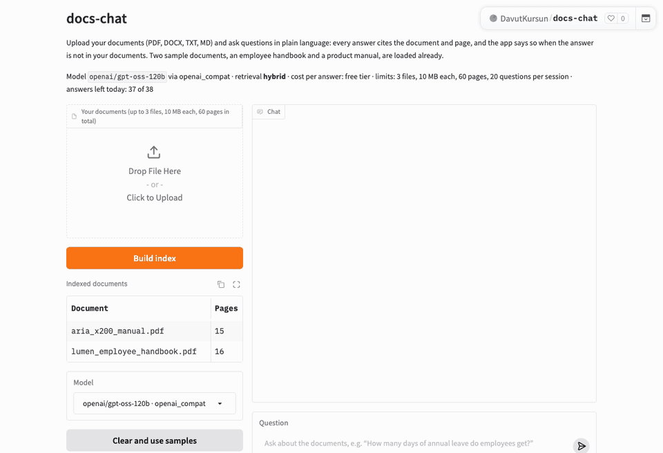

# docs-chat

[](https://huggingface.co/spaces/DavutKursun/docs-chat)
[](https://github.com/DavutKursun/docs-chat/actions/workflows/ci.yml)

**Live demo:** [huggingface.co/spaces/DavutKursun/docs-chat](https://huggingface.co/spaces/DavutKursun/docs-chat) · **How it works:** [docs/DESIGN.md](docs/DESIGN.md)



Upload PDF, DOCX, TXT or MD files in English or Turkish and ask questions in plain language.
Every answer is built only from the retrieved passages and carries `[1]`, `[2]` citations that expand to document, page and passage.
When the answer is not in the documents, the app says "I couldn't find this in the uploaded documents." instead of guessing.
Hybrid retrieval (multilingual embeddings + keyword search) finds error codes, part numbers and amounts exactly; cost and latency are shown under every answer.

## Results

52 questions (38 answerable, 14 unanswerable, 6 in Turkish) over two fictional documents of 31 pages; `openai/gpt-oss-120b` on Groq's free tier as answerer and judge; 350-word chunks, top-6, the same index for both runs (`scripts/eval.py`; tables and failure analysis in [docs/DESIGN.md](docs/DESIGN.md)):

| Metric | Hybrid (default) | Dense only |
|---|---|---|
| Judge: correct / correct + partial | 0.84 / 1.00 | 0.84 / 0.97 |
| Abstention on the 14 unanswerable questions | 14/14 | 14/14 |
| Retrieval hit@6 (gold page among the passages) | 0.97 | 0.95 |
| Answers citing the gold page | 0.92 | 0.89 |
| Latency p50 / p95 (local, paced under the free-tier limit) | 1.1 s / 3.1 s | 0.9 s / 1.3 s |
| Cost per answer | free tier | free tier |

Hand check of 10 judgments: 6 agree with the judge; the 4 disagreements are the judge being stricter than a human reader; no wrong answer was graded correct.
On the Space (12 eval questions through the Gradio API, 12 s apart): latency p50 0.9 s / p95 4.9 s, 1.7 s / 5.5 s end to end; all 10 answerable questions cited a passage, 9 of them the gold page; both unanswerable ones got the exact abstention sentence; about 2,500 tokens per answer.

**Limits and privacy.** The public demo takes 3 files, 10 MB each, 60 pages in total, 20 questions per session and 38 answers per day for all visitors (half of Groq's free daily quota). Files and indexes live in a per-session temporary folder and are deleted on **Clear session** or after 2 hours; nothing is stored beyond the session and no document text is logged. The Space sleeps after 48 h without visitors and wakes in about 50 s.

**Limitations.** No OCR (scanned pages are skipped with a warning), no corpora over 300 pages, no accounts or persistent storage. **Next steps:** the cross-encoder reranker (the flag exists; too slow on the free CPU), a persistent model cache so the Space wakes in seconds instead of ~50 s, and a Claude Haiku option (paid, no per-minute quota) for a higher daily cap.

## Run it yourself

```bash
git clone https://github.com/DavutKursun/docs-chat && cd docs-chat
python3.11 -m venv .venv && source .venv/bin/activate
pip install -r requirements.txt   # Linux: add --extra-index-url https://download.pytorch.org/whl/cpu for the CPU-only torch wheel (skips the ~2 GB CUDA build)
cp .env.example .env
```

Pick the LLM in `.env`. Groq's free tier is the default; any other OpenAI-compatible endpoint (OpenRouter, Mistral, Gemini) works the same way:

```ini
LLM_PROVIDER=openai_compat
LLM_BASE_URL=https://api.groq.com/openai/v1
LLM_API_KEY=gsk_...
LLM_MODEL=openai/gpt-oss-120b    # Groq retires model names: check https://console.groq.com/docs/models
```

Alternative, Claude via the Anthropic API:

```ini
LLM_PROVIDER=anthropic
ANTHROPIC_API_KEY=sk-ant-...
LLM_MODEL=claude-haiku-5-5       # or claude-sonnet-5-5
```

Then, from the command line:

```bash
python scripts/ingest.py eval/sample_docs --out index/     # downloads multilingual-e5-small (~470 MB) once; ~10 s afterwards
python scripts/ask.py --index index/ "What does error code E3 mean?"
```

Or the web UI:

```bash
python app.py                     # loads the embedder (~10 s), then serves http://127.0.0.1:7860
```

The sample documents are indexed when the page opens, so you can ask straight away. Upload your own PDF/DOCX/TXT/MD files and click **Build index** to replace them, **Clear and use samples** to go back. Each answer streams in with `[n]` citation chips, a collapsible list of the cited passages (document, page, text) and a grey `retrieval · cost · latency · passages` line. **Clear session** deletes your files and index; otherwise they are deleted after 2 hours.

Offline smoke test without downloading any model: `EMBEDDER=hash python scripts/ingest.py eval/sample_docs --out index/` (not semantic — for tests only). `scripts/smoke_space.py` starts the app the way a Space does and asks one question headlessly; `scripts/demo_gif.py` re-records the demo GIF (Playwright in a throwaway venv, instructions in the file).

Tests: `pip install -r requirements-dev.txt && pytest` (no network, no API key, no SDK or torch needed).

Deployment: the Space is updated through the Hub API from `app.py`, `docs_chat/`, the sample PDFs, `space/README.md` and `requirements-space.txt`; the only secret is `LLM_API_KEY`, set in the Space settings.

## Stack

Python · sentence-transformers (multilingual-e5-small) · FAISS · BM25 · any OpenAI-compatible LLM API (Groq, OpenRouter, Mistral, Gemini) or the Claude API · Gradio · pytest · GitHub Actions · Hugging Face Spaces

## License

MIT
